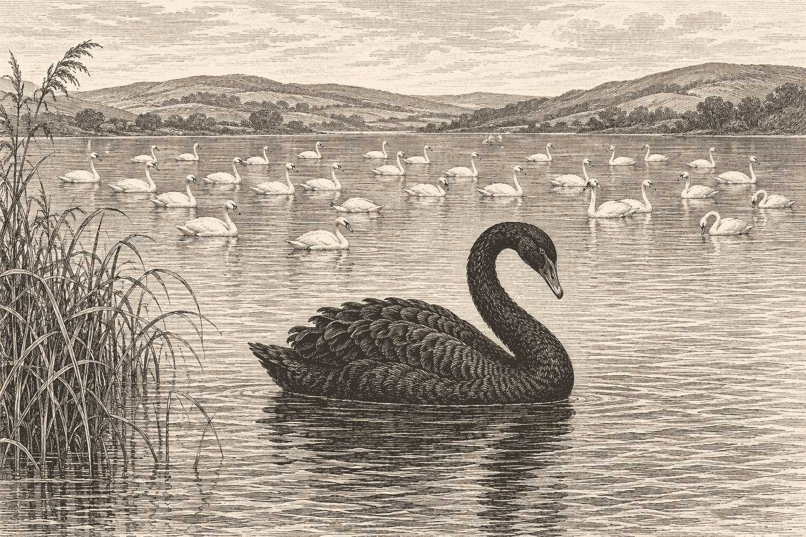

Nearly half a million impressions on one LinkedIn post. 100,000+ on one Medium post. Same thing on Instagram.

Nothing I posted before predicted any of it.

That's a black swan event: a result so far out of distribution that your past numbers say it's impossible. Power law stuff.

You can't time it. You keep showing up, and one day the factors that usually fight each other all point the same way.

And the bet is kinda free. A bad post sinks. Nobody notices, all you get is silence. A good one gets you noticed. Almost no downside, only upside.

We still hold back. Loss aversion, thanks evolution.

Investors fear missing the deal more than losing money on one.

Apple started with computers. Its best seller today is the iPhone.

So take more shots, and build the system that takes them for you.

10x is easier than 2x. 2x is working twice as hard, and you can't do that all your life. 10x can't come from effort, there are only 24 hours in a day. You have to change the strategy completely: do less yourself, build the system, keep improving it.

I'm building agent swarms that work in the background 24/7 to find opportunities for me.

Increase your luck surface area 🔮
