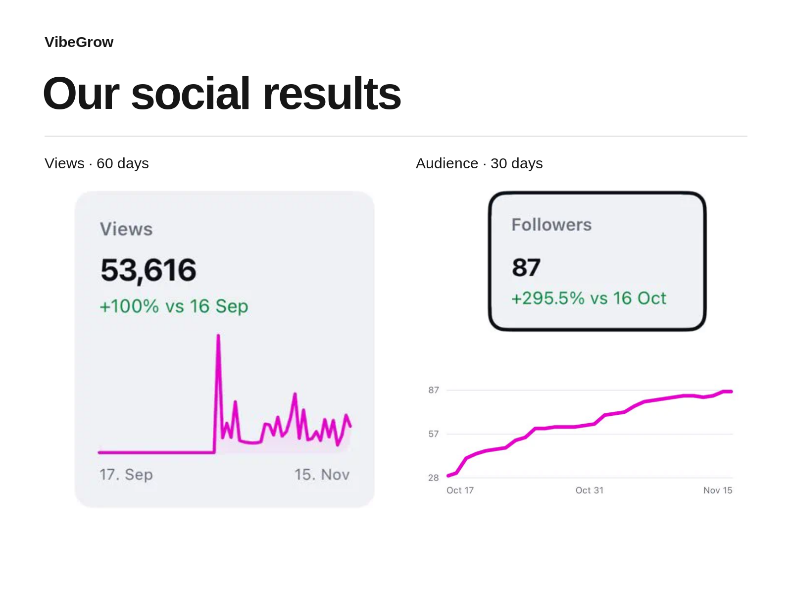

53,616 views since mid-October, on full autopilot.

That is the AI perfume influencer Aman Gokrani runs. He did not post once by hand.

He spent the month building and tuning the system that posts every day. Most of that work was alignment: getting the voice right, figuratively and literally.

A year ago this would have been slop, or hours of manual effort every day.

Customer outreach, security response, rolling out fixes, verifying changes, clearing alerts, support, moderation.

Each one has the same human bottleneck. It is the knowledge-work version of manual labour before industrialisation. Humans have solved this problem before.

Artisan bread is still valuable, and most people do fine with regular bread.

A bakery becomes a unicorn only when it becomes a franchise.

Founders already delegate their vision to employees and keep correcting direction and taste.

As they say: a computer can never be held accountable, so a computer must never make a management decision. That still holds.

A person has a stake when something goes wrong. A model's reward exists at training time and is gone at inference. That is the continual learning problem. In-context learning is a partial proxy today, and the feedback loop keeps getting shorter.

So the new factory floor is one person supervising a swarm of agents. The person sets the goal and the taste.

I am reaching out to investors and customers the same way, through my own agent swarms.

Human touch stays valuable. Scale your knowledge work the way we scaled manual work.

It is a second industrial renaissance.

Pick one task you repeat every day. Hand it to a swarm.

Go one level up with [VibeGrow](https://vibegrow.io).
