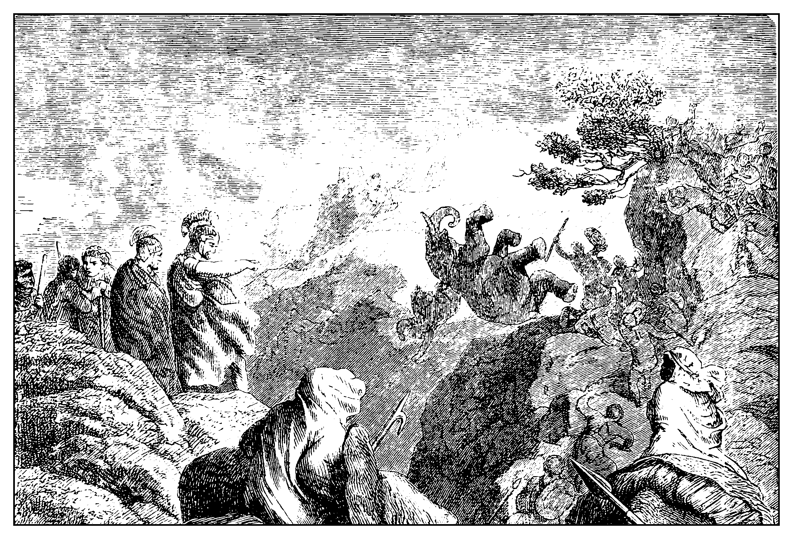

<figure class="plate"><figcaption>“We will either find a way, or make one.”<small>Hannibal crossing the Alps, <i>The Illustrated History of the World</i>, c. 1881</small></figcaption></figure>

Today I saw a video by Shantanu Deshpande that put words to something I've felt for a long time: why working with some leaders is such a joy, and with others, so draining.

There are three types of leadership:

- Perspirational
- Inspirational
- Aspirational

Perspirational leaders rely on tracking, follow-ups and fear alone to get work done. It's generally their default way of managing, and it quickly turns into toxic micromanagement.

Inspirational leaders make you want to do the work. Their influence stays with you for years. They're the people you credit for some of the best years of your professional life. Everyone wants to work with them.

Aspirational leaders make you think, “I want to become like this person.” These are the rarest. The founders and leaders whose influence reaches beyond their own companies. People elsewhere look up to them too.

Looking back, the people I've most enjoyed working with were inspirational or aspirational.

They created high-trust environments where high-agency people could make stuff happen without being micromanaged. They gave people the freedom to grow themselves as well as the org.

Perspirational people create work behind the work: tracking the work, tracking the updates, then following up on the tracking. High-agency people eventually get tired of spending more time proving they're working than actually doing the work.

Aspirational leaders sit down with people, talk things through and build belief in what they're doing.

A founder's job is to keep selling that belief to customers, employees and everyone building alongside them: this matters, and we can make it happen. They give people a reason to care and trust them to deliver.

It brings to mind the Rome vs. Carthage analogy for me: how do you respond when people take a risk and fail?

With the leaders I've most enjoyed working with, failures were treated as opportunities to learn. Victories were celebrated heartily.

Nobody had to think ten times before proposing something, because they knew the best parts of their idea would be developed, rather than everyone hyperfocusing on the weak parts. And if you saw something wrong, you had an obligation to dissent: speak up and help fix it, regardless of who proposed it.

Action produces information. Good leaders encourage initiative and collaboration because they understand this is a positive-sum game. The pie gets bigger!

People working with them don't operate out of fear, but out of shared belief and excitement.

Perspirational leaders romanticize suffering. The leaders I respect care about outcomes and welcome good ideas, no matter where they come from.

I've been lucky to work with some genuinely inspirational and aspirational leaders. All my respect to them.

Be a leader who inspires. Even better, be the leader others aspire to be.
